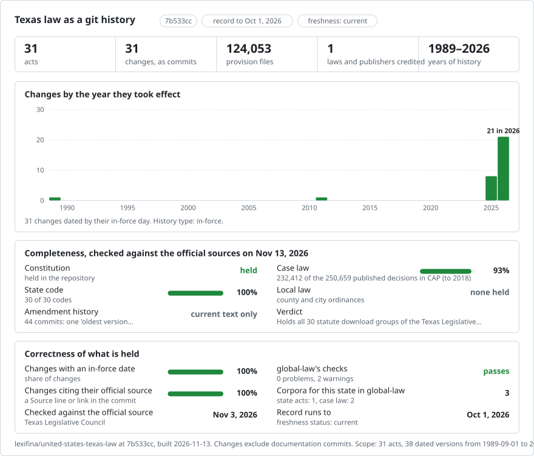

# Texas: law history in git

<picture>
<source media="(prefers-color-scheme: dark)" srcset="data/effort-dark.svg">

</picture>

Part of [lexifina/global-law](https://github.com/lexifina/global-law), one git history for every country's law: this is the law of Texas, United States, which global-law reads at `united-states/texas/acts/`.

This repository holds all 31 download groups listed by the Texas Legislative Council, including the Constitution and Vernon's Civil Statutes. The Constitution has Council editions dated March 1996, February 1998, January 2000, January 2003 and November 2003, followed by the current text. The earlier editions are complete single-file snapshots. The other 30 groups have one current-text version per section. Session laws and regulations are outside this record.

| Folder | Act | Sections | Version date |
| --- | --- | ---: | --- |
| `constitution/` | Constitution of the State of Texas | 516 current; 1 per historical edition | 1995-11-07, 1997-11-04, 1999-11-02, 2002-11-05, 2003-09-13, 2025-11-04 |
| `penal-code/` | Texas Penal Code | 467 | 2025-12-04 |
| `property-code/` | Texas Property Code | 1,782 | 2026-01-01 |
| `business-organizations-code/` | Texas Business Organizations Code | 1,362 | 2026-01-01 |
| `agriculture-code/` | Texas Agriculture Code | 2,158 | 2025-09-01 |
| `alcoholic-beverage-code/` | Texas Alcoholic Beverage Code | 833 | 2025-09-01 |
| `auxiliary-water-laws/` | Texas Auxiliary Water Laws | 69 | 1989-09-01 |
| `business-and-commerce-code/` | Texas Business & Commerce Code | 1,857 | 2026-09-01 |
| `civil-practice-and-remedies-code/` | Texas Civil Practice and Remedies Code | 1,477 | 2025-12-04 |
| `code-of-criminal-procedure/` | Texas Code of Criminal Procedure | 2,367 | 2026-04-01 |
| `education-code/` | Texas Education Code | 5,743 | 2026-09-01 |
| `election-code/` | Texas Election Code | 2,053 | 2025-12-04 |
| `estates-code/` | Texas Estates Code | 1,898 | 2026-01-01 |
| `family-code/` | Texas Family Code | 2,406 | 2025-12-04 |
| `finance-code/` | Texas Finance Code | 2,836 | 2026-01-01 |
| `government-code/` | Texas Government Code | 14,728 | 2026-10-01 |
| `health-and-safety-code/` | Texas Health and Safety Code | 8,552 | 2026-09-01 |
| `human-resources-code/` | Texas Human Resources Code | 1,623 | 2026-09-01 |
| `insurance-code/` | Texas Insurance Code | 7,832 | 2026-01-01 |
| `insurance-code-not-codified/` | Texas Insurance Code - Not Codified | 53 | 2011-09-01 |
| `labor-code/` | Texas Labor Code | 1,796 | 2026-01-01 |
| `local-government-code/` | Texas Local Government Code | 5,338 | 2026-06-01 |
| `natural-resources-code/` | Texas Natural Resources Code | 2,297 | 2025-09-01 |
| `occupations-code/` | Texas Occupations Code | 7,010 | 2026-09-01 |
| `parks-and-wildlife-code/` | Texas Parks and Wildlife Code | 1,487 | 2025-09-01 |
| `special-district-local-laws-code/` | Texas Special District Local Laws Code | 31,523 | 2026-01-01 |
| `tax-code/` | Texas Tax Code | 2,125 | 2026-09-01 |
| `transportation-code/` | Texas Transportation Code | 5,662 | 2026-09-01 |
| `utilities-code/` | Texas Utilities Code | 1,766 | 2026-09-01 |
| `water-code/` | Texas Water Code | 4,139 | 2026-09-01 |
| `vernon-s-civil-statutes/` | Texas Vernon's Civil Statutes | 267 | 2025-10-01 |

## Source and dates

The Texas Legislative Council publishes the Constitution and statutes at <https://statutes.capitol.texas.gov/>. The text here comes from its per-code HTML downloads, including the Council's section source notes. Article and chapter headings between sections are outside this section-level record.

The Constitution has five earlier Council edition snapshots; the other acts have one version, the oldest available here. For each current code, the version date is the latest applicable in-force date in the Council's section source notes on or before 3 November 2026, or the retrieval day if no source date appears. The Constitution's historical edition dates are the latest amendment days printed in each edition. The Constitution's 1995, 1997, 1999, 2002 and 2003 dates are the latest amendment days printed in the respective historical editions. The dates of the other acts describe current-text snapshots; they do not reconstruct earlier history. The Council is credited as publisher.

Sections that the source says take effect after 3 November 2026 are excluded. Some subsection-level future variants remain as the Council prints them. Files that the Council names `*_old.htm` are outside the current-text record.

The source's punctuation is preserved, including curly quotation marks and dashes. This is an unofficial reproduction; consult the Council's publication for legal use.
